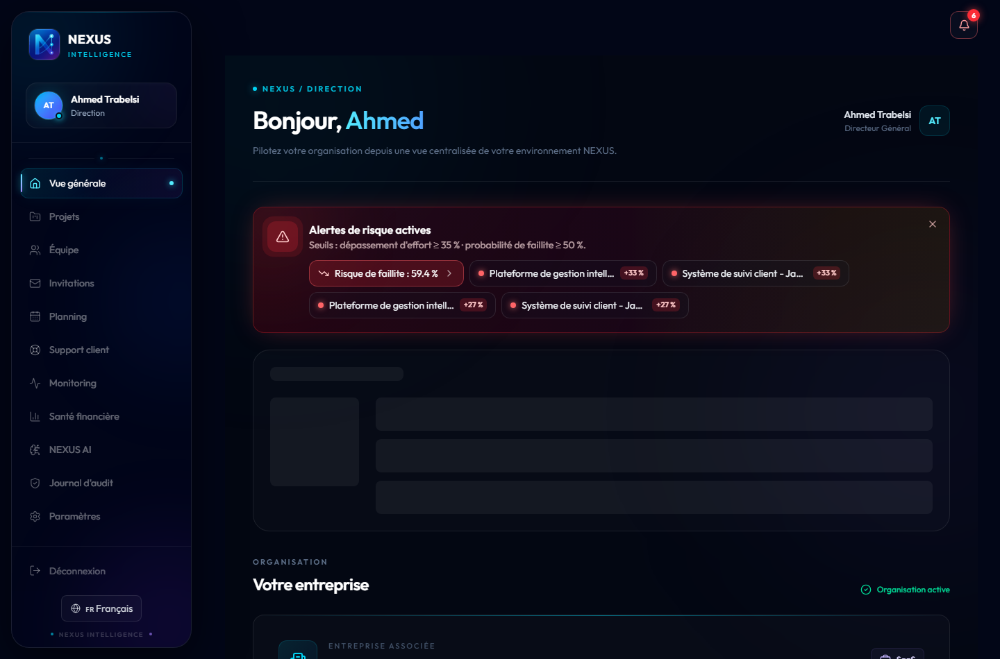
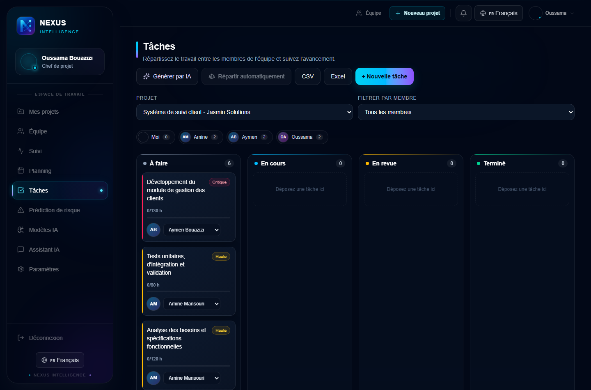
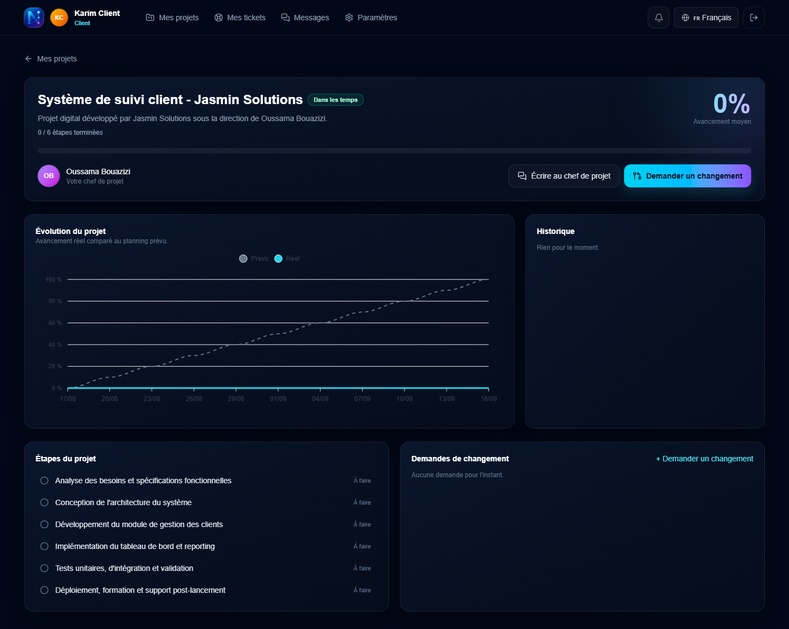
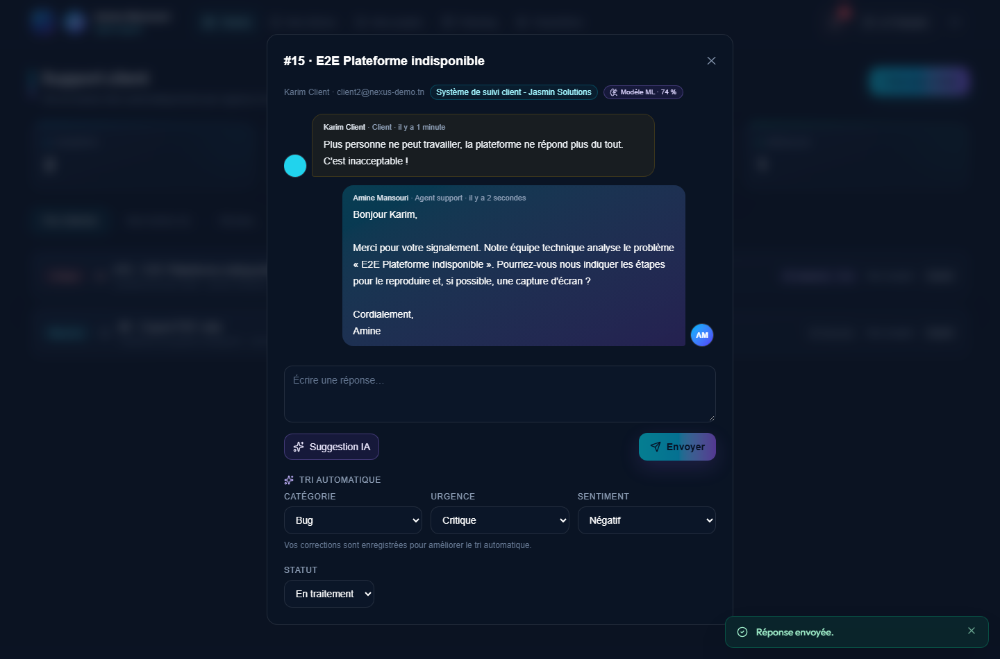
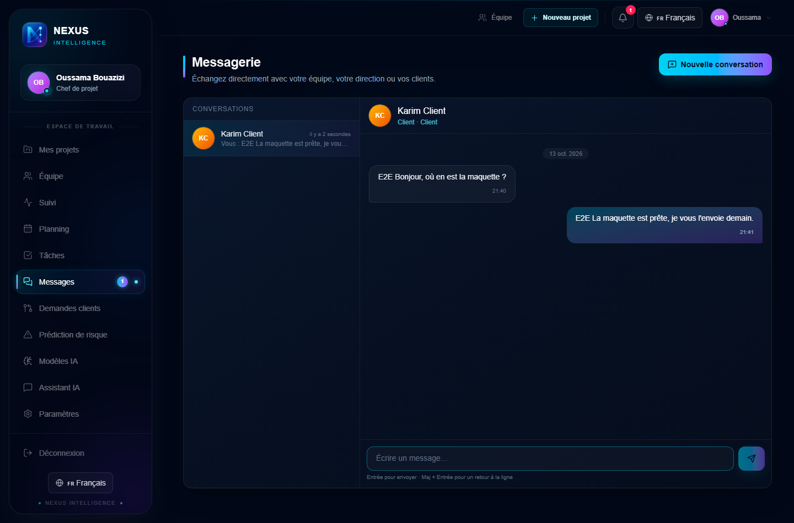

# NEXUS AI

**AI-powered management platform for digital agencies.** NEXUS AI brings projects, customer support and finances into one place, and uses three machine-learning models to spot problems before they happen.

Built by **Ons Alouini** during an engineering internship at **Anypli** (Monastir, Tunisia), ESPRIM, Data Science & AI track, 2026.



## Why

Digital agencies, especially small ones, usually face three problems separately:

- **Underestimated projects.** Effort and deadlines are estimated by intuition, and overruns are discovered too late.
- **Unprioritized support.** Tickets are handled in arrival order, so urgent issues and unhappy customers wait.
- **Scattered information.** Project risk, customer satisfaction and financial health live in different tools.

NEXUS AI replaces "finding out too late" with "seeing it coming", with predictions that are always explained.

## Three AI models

| Model | Data | Algorithm | Result | Used for |
|---|---|---|---|---|
| **Project risk** | PROMISE / Desharnais, 81 real software projects | Gradient Boosting (12 features, incl. 4 engineered) | R² = 0.666 | Predicts real effort when a project is created; the gap with the planned budget gives a Low / Moderate / High risk level |
| **Financial health** | Kaggle Company Bankruptcy Prediction, 6,819 companies | XGBoost, isotonic calibration | ROC-AUC 0.932, 80 % of bankruptcies detected | Bankruptcy probability, health score out of 100, SHAP explanation, PDF report |
| **Ticket triage** | 6,000 tickets in French, English and Arabic (Kaggle support-ticket CSV also supported) | TF-IDF (characters + words) and logistic regression | 89 % urgency, 74 % category, 99.8 % sentiment on unseen phrasings | Sorts every ticket by category, urgency and sentiment; agents' corrections retrain the model |

Scores and percentages always come from the models or from deterministic code. The LLM (Groq) only writes text: project reports, the assistant and draft replies.

## Features

- **Five role-based workspaces:** direction, project manager, team member, support agent and external client. Accounts are created only through single-use invitations.
- **Projects and tasks:** Kanban board, AI-generated tasks, automatic assignment based on workload and capacity, calendar and Gantt planning, burndown and completion forecast.
- **Proactive alerts:** thresholds set by the direction for project risk and bankruptcy probability. Alerts go out as an in-app notification, an email (Brevo) and a dashboard banner.
- **Client portal:** clients follow their project's progress (actual vs planned), request changes and open tickets with a conversation thread.
- **Internal messaging:** project manager ↔ direction, project manager ↔ team, client ↔ project manager, with unread counts and read receipts.
- **Security:** Sanctum tokens, email verification, TOTP two-factor authentication, data isolated per company and per role, audit log.
- **Three languages:** French, English and Arabic, with full right-to-left layout.

| Tasks and automatic assignment | Client project tracking |
|---|---|
|  |  |
| **Ticket triaged by the ML model, with an AI-drafted reply** | **Internal messaging** |
|  |  |

## Architecture

```
Browser ──HTTPS──> React 19 SPA (Vercel)
                        │ REST + Sanctum token
                        v
                  Laravel 12 API (Render, Docker) ──SQL──> MySQL (Aiven)
                        │
        ┌───────────────┼────────────────┬──────────────────┐
        v               v                v                  v
  Risk model       Finance model     Ticket model      Groq (LLM) · Brevo (email)
  FastAPI :8001    FastAPI :8002     FastAPI :8003
```

| Layer | Technologies |
|---|---|
| Frontend | React 19, TypeScript, Vite, Tailwind CSS 4, i18next, ApexCharts, FullCalendar |
| Backend | Laravel 12, PHP 8.2, Sanctum, DomPDF, PHPUnit (39 tests) |
| AI services | Python, FastAPI, scikit-learn, XGBoost, SHAP, pandas |
| Cloud | Vercel, Render (Docker + `render.yaml`), Aiven MySQL, Brevo, Groq |

## Run locally

```bash
# Backend
cd backend-laravel
cp .env.example .env        # set DB_*, GROQ_API_KEY, BREVO_*, AI service URLs
composer install && php artisan key:generate
php artisan migrate --seed   # demo data
php artisan serve            # http://localhost:8000

# Frontend
cd frontend
npm install && npm run dev   # http://localhost:5173

# AI services (Python 3.12)
cd ai-services
python -m venv venv && venv/Scripts/activate   # source venv/bin/activate on Linux/macOS
pip install -r requirements.txt
python -m uvicorn main:app --port 8001                                  # project risk
cd finance-service && python -m uvicorn main:app --port 8002           # financial health
cd ../ticket-service && pip install -r requirements.txt \
  && python train.py && python -m uvicorn main:app --port 8003         # ticket triage
```

See [DEV_COMMANDS.md](DEV_COMMANDS.md) for deployment steps and [DEMO.md](DEMO.md) for a full demo scenario with test data.

## Tests

```bash
cd backend-laravel && php artisan test        # 39 backend tests
cd frontend && npm run lint && npm run build  # type-check and build
node frontend/scripts/check-i18n.mjs          # FR / EN / AR translation check
```

## Roadmap

- Retrain the models on Anypli's real project history
- "What-if" simulation before a decision
- Admin role and model monitoring
- Real-time updates (WebSockets) and a mobile app
- Encryption of sensitive data at rest

## Author

**Ons Alouini**, engineering student in Data Science & AI at ESPRIM (Monastir).
Internship at Anypli, supervised by Mrs. Faten Hamila.
